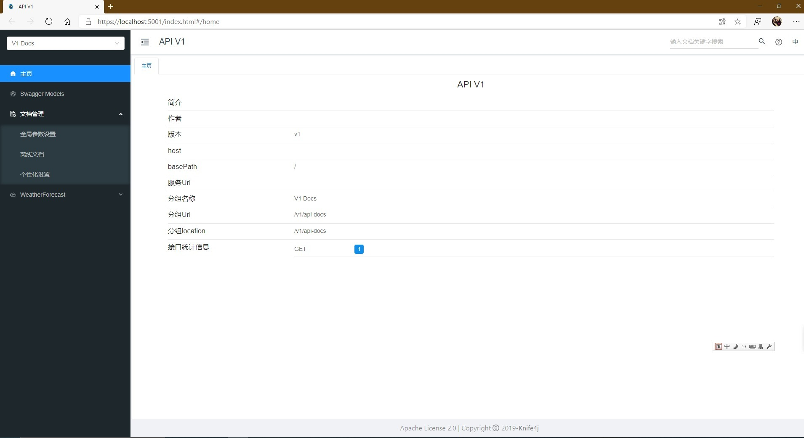
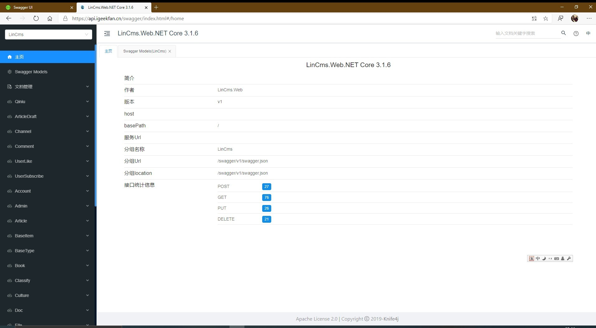

**English** | [简体中文](README.zh-CN.md)

# IGeekFan.AspNetCore.Knife4jUI

A Swagger UI library using **[Knife4j UI](https://gitee.com/xiaoym/knife4j)**, supporting .NET Core 3.0+ and .NET Standard 2.0.


[](https://www.nuget.org/packages/IGeekFan.AspNetCore.Knife4jUI) [](https://www.nuget.org/stats/packages/IGeekFan.AspNetCore.Knife4jUI?groupby=Version) [](https://raw.githubusercontent.com/luoyunchong/IGeekFan.AspNetCore.Knife4jUI/master/LICENSE.txt)

<a name="相关依赖项"></a>

## Dependencies
### [knife4j](https://gitee.com/xiaoym/knife4j/tree/master/knife4j-vue)
- knife4j-vue
### [Swashbuckle.AspNetCore](https://github.com/domaindrivendev/Swashbuckle.AspNetCore)
- Swashbuckle.AspNetCore.Swagger
- Swashbuckle.AspNetCore.SwaggerGen

## Demo
- [Basic](https://github.com/luoyunchong/IGeekFan.AspNetCore.Knife4jUI/blob/master/test/Basic)
- [Knife4jUIDemo](https://github.com/luoyunchong/IGeekFan.AspNetCore.Knife4jUI/blob/master/test/Knife4jUIDemo)

<a name="-快速开始"></a>

## 📚 Quick start

<a name="安装包"></a>

### 🚀 Install packages

The following example uses Swashbuckle.AspNetCore.Swagger.

1.Install the standard Nuget package into your ASP.NET Core application.

```
Package Manager : 

Install-Package Swashbuckle.AspNetCore.Swagger
Install-Package Swashbuckle.AspNetCore.SwaggerGen
Install-Package IGeekFan.AspNetCore.Knife4jUI

OR

CLI :

dotnet add package Swashbuckle.AspNetCore.Swagger
dotnet add package Swashbuckle.AspNetCore.SwaggerGen
dotnet add package IGeekFan.AspNetCore.Knife4jUI
```

2.In the ConfigureServices method of Startup.cs, register the Swagger generator, defining one or more Swagger documents.

```
using Microsoft.AspNetCore.Mvc.Controllers
using Microsoft.OpenApi.Models;
using Swashbuckle.AspNetCore.SwaggerGen;
using IGeekFan.AspNetCore.Knife4jUI;
```
### 🚁 ConfigureServices

3. Configure the service. CustomOperationIds and AddServer are required.
```
   services.AddSwaggerGen(c =>
    {
        c.SwaggerDoc("v1",new OpenApiInfo{Title = "API V1",Version = "v1"});
        c.AddServer(new OpenApiServer()
        {
            Url = "",
            Description = "vvv"
        });
        c.CustomOperationIds(apiDesc =>
        {
            var controllerAction = apiDesc.ActionDescriptor as ControllerActionDescriptor;
            return  controllerAction.ControllerName+"-"+controllerAction.ActionName;
        });
    });
```

### 💪 Configure
4. Configure the middleware.
```
app.UseSwagger();

app.UseKnife4UI(c =>
{
    c.RoutePrefix = ""; // serve the UI at root
    c.SwaggerEndpoint("/v1/api-docs", "V1 Docs");
});

app.UseEndpoints(endpoints =>
{
    endpoints.MapControllers();
    endpoints.MapSwagger("{documentName}/api-docs");
});
```

5. Additional features

To add documentation comments, right-click the project and select Properties → Build.


Add the following code to AddSwaggerGen:

```
c.IncludeXmlComments(Path.Combine(AppContext.BaseDirectory, "SwaggerDemo.xml"),true);
```
 Set the final argument to true to enable controller comments.

If controller comments do not appear, open Document Management → Personalization and enable the description attribute for grouped tags.


### NSwag.AspNetCore
(See the test/WebSites/NSwag.Swagger.Knife4jUI directory.)

```
public void ConfigureServices(IServiceCollection services)
 {
    // Other services
     services.AddOpenApiDocument();
 }
```

```
public void Configure(IApplicationBuilder app, IWebHostEnvironment env)
{
            // Other middleware
          app.UseOpenApi();
          app.UseKnife4UI(c =>
         {
               c.RoutePrefix = "";
               c.SwaggerEndpoint("/swagger/v1/swagger.json", "V1 Docs");
          });
}
```

Knife4jUI is now ready to use.

<a name="-效果图"></a>

### 🔎 Preview
Run the project and open https://localhost:5001/index.html#/home




<a name="更多配置请参考"></a>

### More configuration

- [https://github.com/domaindrivendev/Swashbuckle.AspNetCore](https://github.com/domaindrivendev/Swashbuckle.AspNetCore)


<a name="更多项目"></a>

### More projects

- [https://api.igeekfan.cn/swagger/index.html](https://api.igeekfan.cn/swagger/index.html)
- [https://github.com/luoyunchong/lin-cms-dotnetcore](https://github.com/luoyunchong/lin-cms-dotnetcore)

